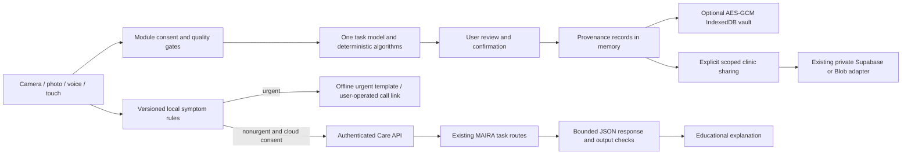

# Everyday companion architecture

The merged application uses Next.js App Router and React. `/` is a workspace chooser, `/dashboard` contains the React patient/caregiver workspace, `/assistive.html` preserves the complete HTML/ES-module assistive app, and `/everyday.html` opens the independent Everyday workspace. Existing `/app` and module/role entry links redirect to the retained assistive app. Private invitation credentials remain in the browser fragment.

Everyday continues to use the same MediaPipe assets, browser speech infrastructure, MAIRA provider and private server store. The migration adds the Next.js/React runtime; it adds no database schema, external auth provider or trained checkpoint.

| Source location | Responsibility / public URL |
| --- | --- |
| `src/app` and `src/features` | React pages, dashboard flows and client state |
| `public/assistive.html`, `public/engine/main.js` | Retained assistive entry and its established UI logic |
| `public/everyday.html`, `public/app/everyday` | Everyday HTML and browser ES modules; URLs remain `/everyday.html` and `/app/everyday/*` |
| `public/engine` | Shared inference, calibration, signals and speech modules served at `/engine/*` |
| `public/neuroface`, `public/models` | Existing vendor runtimes, notices and model weights |
| `src/app/api/*/route.ts` | Node-runtime Next route handlers for Asha, Care, Clinic, session, health and cleanup |
| `src/server/handlers` | Existing Node-style request/response handlers adapted by `src/server/node-adapter.ts` |
| `src/server/lib` | Provider, orchestration, safety integration, clinic service, retention and private store adapters |

`public/app/everyday/contracts.js` defines the JSDoc evidence contract and runtime validation. `EvidenceStore` owns local saving consent, encryption, retention and deletion. `CameraManager` owns a single stream/model and cancels late startup on navigation, backgrounding or model failure. `ModelManager` validates weight bytes before the existing MediaPipe runtime loads them; it tries GPU then CPU/WASM. WebGPU is detected as a device capability, not claimed as a separately implemented runtime.

Nutrition uses attributed ingredient records and deterministic gram arithmetic. Move uses aspect-correct camera-plane joint geometry, One Euro filtering and complete-cycle state machines. EyeSpeak fits personal iris/head regression, then requires held-out target checks before dwell selection. Care evaluates local rules before cloud authorization or generation. The existing assistive app retains its own established camera lifecycle; leaving it for Everyday is full navigation, and Everyday stops its camera before any module transition.

`/api/clinic` uses random capability credentials, hashed at rest, tenant-prefixed keys, server-enforced roles, per-patient sharing grants and audited actions. This is a demo access mechanism matching the existing private-link design, not identity verification or a clinical account system. Billing is a future tenant-scoped concern; no payment integration exists.

All API routes now execute locally through Next during development. `src/server/lib/common.js` selects the existing private Supabase/Blob store, or explicitly enabled in-memory storage when `ASHA_MEMORY_STORE=1` outside production. The adapter retains the standard 20,000-character request bound and the Clinic route's 660,000-character bound for selected record batches. Private API responses, including parse/size failures, use `no-store`; private Blob JSON reads bypass overwrite caching with `useCache: false`.

Both Asha and Care apply the canonical `public/app/everyday` safety rules before authentication, storage reads, provider discovery or cloud consent checks for urgent reports. The authenticated cleanup route still runs Everyday workspace/record retention. Care's nonurgent provider path requires the existing server MAIRA credentials and authenticated session; an unavailable provider falls back to local educational guidance. No private key appears in a client bundle.

The preceding static Everyday release, `6f11e60`, was approved, deployed and verified in production. This Next.js merge is a separate local integration whose build and compatibility checks must complete before release. See `DEPLOYMENT_NOTES.md` and `VALIDATION_PLAN.md` for the distinction.
